# Islam Safari — Desert & Oasis Trips Website

A multilingual tourism website for safari, camping and 4x4 trips in the Bahariya Oasis, White Desert, Heiz Spring, Crystal Mountain and Black Desert. Built with Next.js 16, React 19 and Tailwind CSS v4, with full support for seven languages, light/dark themes, SEO and responsive layouts.

**Live Demo:** [https://islam-safari.vercel.app/en](https://islam-safari.vercel.app/en)

## Quick Look

[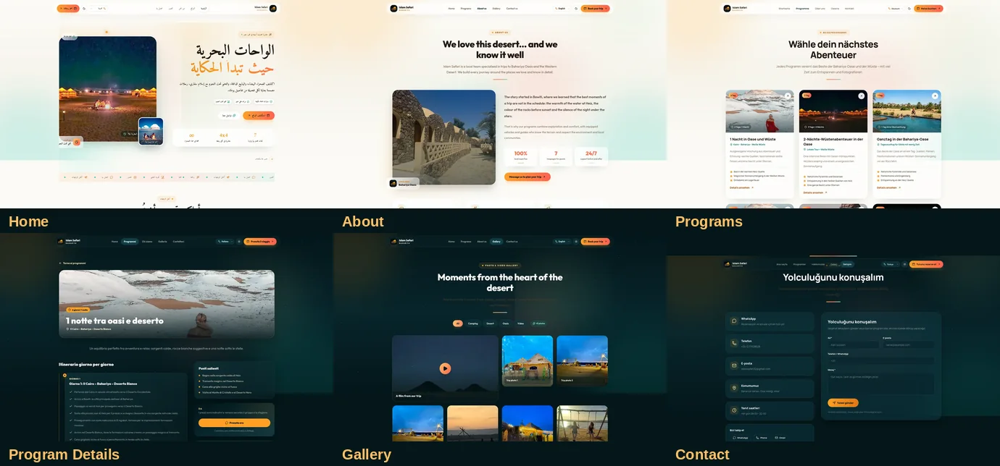](docs/screenshots/overview.webp)

[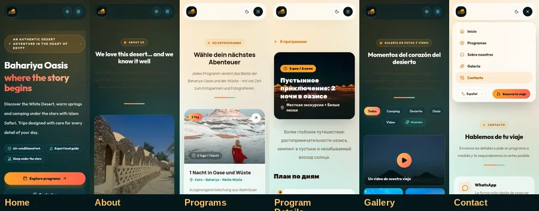](docs/screenshots/mobile-overview.webp)

Desktop previews are normalized to 1280×800 and mobile previews to 360×780. The original full-page captures are kept in [`docs/screenshots/full/`](docs/screenshots/full/).

## Features

- Seven locales with `hreflang` and canonical URLs for every page: Arabic, English, German, Italian, Russian, Spanish and Turkish.
- Responsive design from 320px up to ultra-wide screens, with complete RTL support for Arabic.
- Light and dark themes with the visitor's choice persisted.
- Smooth animations and visual effects powered by Framer Motion and CSS.
- Pages: Home, About, Programs, Program Details, Gallery, Contact and a custom 404 page.
- Seven tour programs and six interactive place cards with detail modals.
- Gallery with category filters, a lightbox and a video card.
- Contact form that opens a pre-filled WhatsApp message with no backend required.
- Localized SEO: metadata, keywords, OpenGraph/Twitter cards, JSON-LD, `robots.txt` and `sitemap.xml`.
- Site favicons generated from the Islam Safari logo, with the Next.js dev indicator disabled.

## Requirements

- Node.js `>=20.9.0` (v24 was used during development).
- npm or any compatible package manager.

## Getting Started

```bash
npm install
npm run dev
```

Open `http://localhost:3000`; you will be redirected to `/ar` automatically. Use the language switcher in the header to change locales, or open a path such as `/en` or `/de` directly.

### Environment Variables

Create a `.env.local` file in the project root when needed:

```bash
NEXT_PUBLIC_SITE_URL=http://localhost:3000
```

In production, replace this with your real domain. It is used for absolute URLs, `sitemap.xml` and `robots.txt`. If the variable is not set, the project falls back to `http://localhost:3000`.

## Scripts

| Command | Description |
| --- | --- |
| `npm run dev` | Start the development server with Turbopack |
| `npm run build` | Create the production build and prerender pages |
| `npm run start` | Serve the production build |
| `npm run lint` | Run ESLint |
| `npm run typecheck` | Run TypeScript without emitting files |

## Stack & Tools

| Layer | Tool | Usage |
| --- | --- | --- |
| Framework | Next.js 16.4.6 (App Router + Turbopack) | Routing, rendering, metadata and image optimization |
| UI | React 19.3 | Component-based interfaces |
| Language | TypeScript 5 | Type-safe development |
| Styling | Tailwind CSS v4 | Design system and responsive utilities |
| i18n | next-intl 4 | Seven locales and all UI translations |
| Themes | next-themes 0.4 | Light/dark mode |
| Motion | Framer Motion 14 | Animations and transitions |
| Icons | Lucide React 1.73 | Vector icons |
| Quality | ESLint 9 + `tsc --noEmit` | Pre-release checks |
| Images | `next/image` + WebP | Optimized loading and LCP |
| Screenshots | Firefox headless + Pillow | Real-page captures and normalized previews |

## Project Structure

```text
src/
├─ app/
│  ├─ [locale]/               # Pages for each locale
│  │  ├─ about/ contact/ gallery/ programs/
│  │  └─ layout.tsx           # Shell, metadata and JSON-LD
│  ├─ globals.css             # Theme, colors, animations and RTL rules
│  ├─ icon.png / apple-icon.png
│  ├─ robots.ts / sitemap.ts
│  └─ not-found (inside [locale])
├─ components/
│  ├─ home/                   # Hero, Places, Camping, Features...
│  ├─ gallery/ programs/ contact/ layout/ ui/
├─ data/content.ts            # Places, programs and image paths
├─ i18n/routing.ts            # Locale definitions
├─ lib/
│  ├─ site.ts                 # Name, contact, social links and site URL
│  └─ seo.ts                  # Canonical/hreflang and page metadata helpers
└─ proxy.ts                   # Locale routing
messages/*.json               # Translations for all seven locales
public/images/                # Site images and icons
docs/screenshots/             # Normalized previews and full-page captures
```

## Screenshots

| Page | Desktop | Mobile |
| --- | --- | --- |
| Home | <a href="docs/screenshots/home-desktop.webp">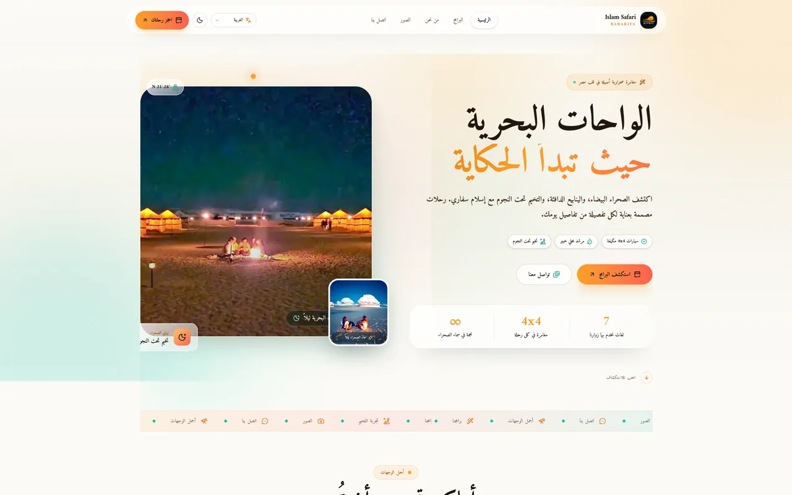</a> | <a href="docs/screenshots/home-mobile.webp">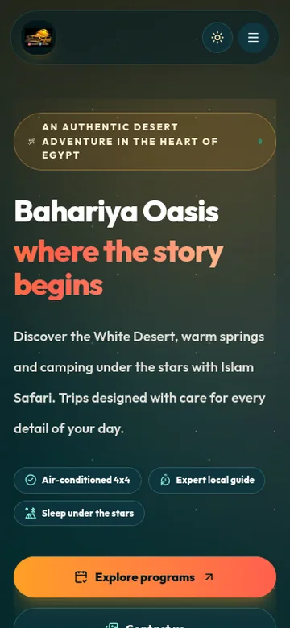</a> |
| About | <a href="docs/screenshots/about-desktop.webp">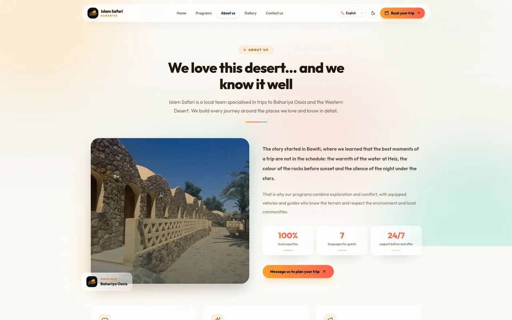</a> | <a href="docs/screenshots/about-mobile.webp">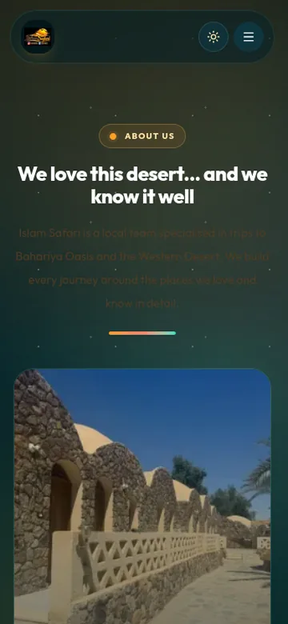</a> |
| Programs | <a href="docs/screenshots/programs-desktop.webp">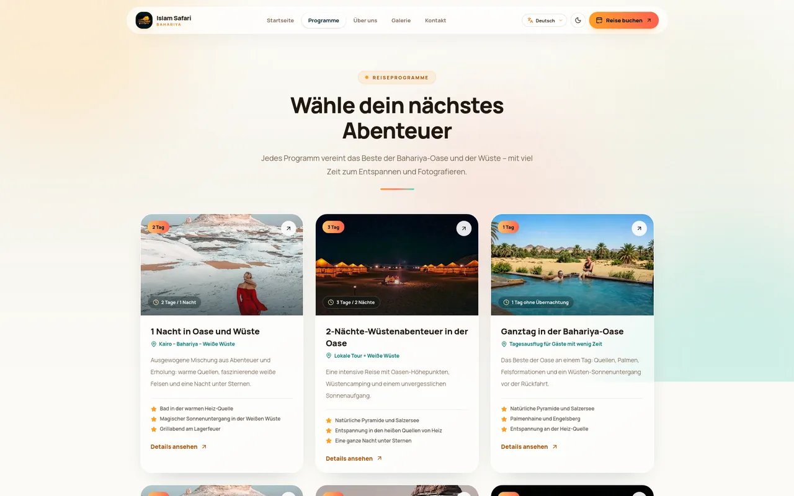</a> | <a href="docs/screenshots/programs-mobile.webp">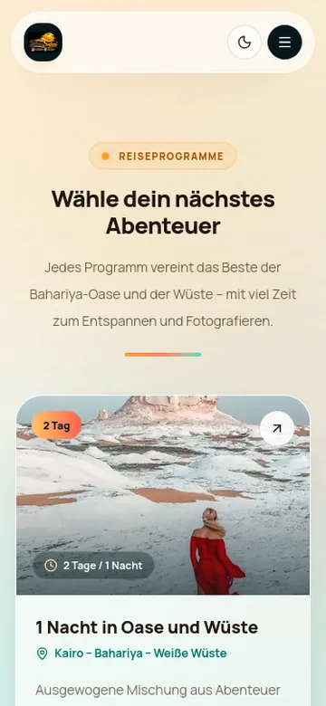</a> |
| Program Details | <a href="docs/screenshots/program-detail-desktop.webp">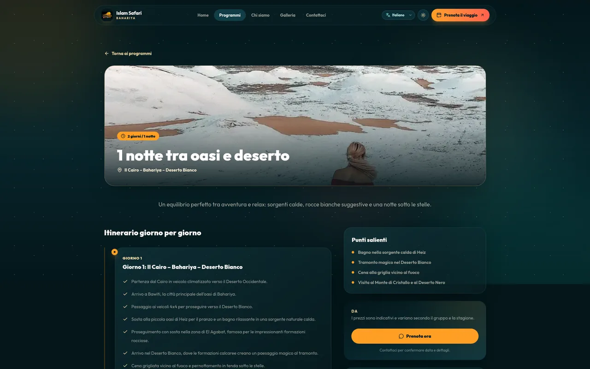</a> | <a href="docs/screenshots/program-detail-mobile.webp">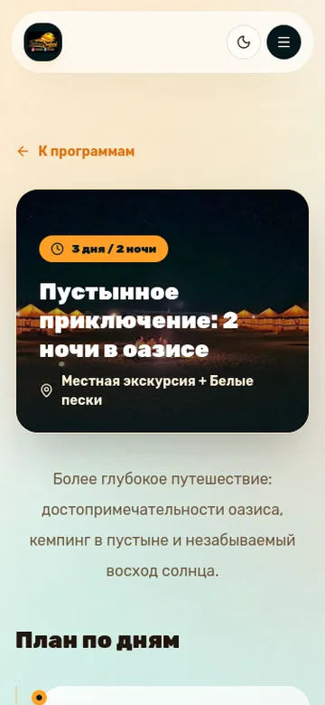</a> |
| Gallery | <a href="docs/screenshots/gallery-desktop.webp">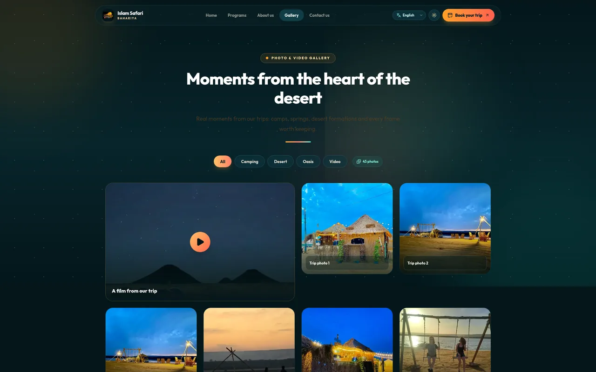</a> | <a href="docs/screenshots/gallery-mobile.webp">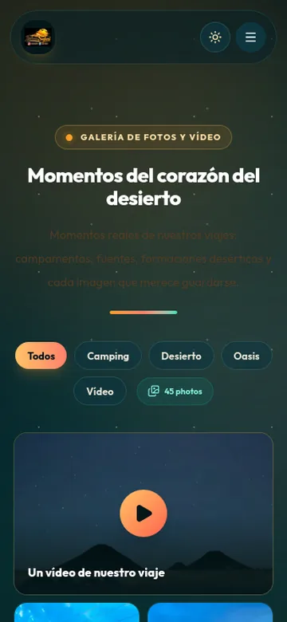</a> |
| Contact | <a href="docs/screenshots/contact-desktop.webp">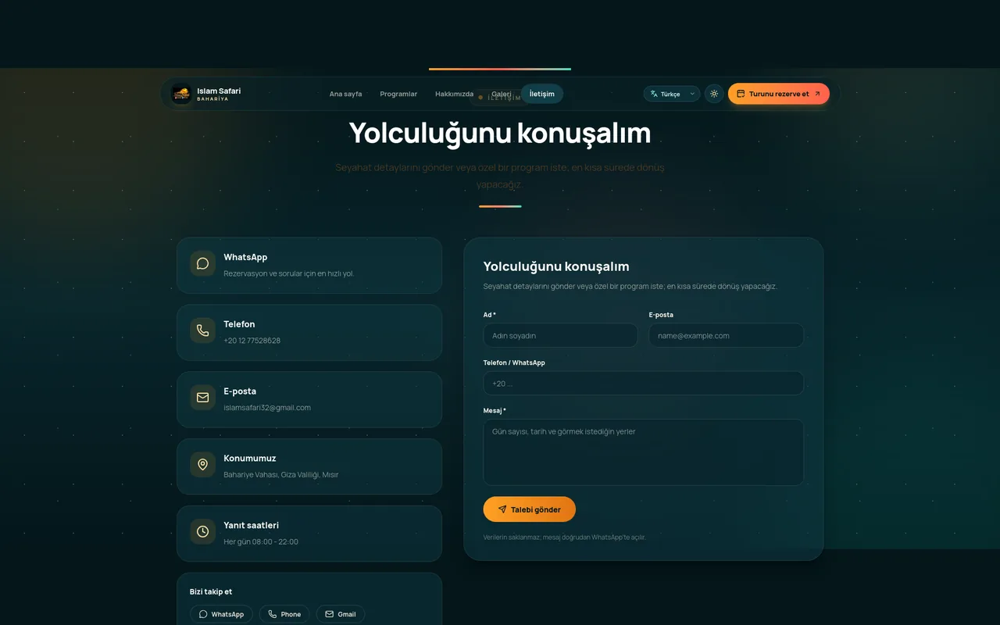</a> | <a href="docs/screenshots/contact-mobile.webp">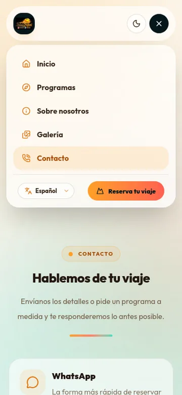</a> |

Click any preview to open the full-size image. Full-page versions are available in [`docs/screenshots/full/`](docs/screenshots/full/).

## Editing Content

- All copy lives in `messages/*.json`. Update the same key in all seven locale files to keep the site consistent.
- Program names, places and image paths are defined in `src/data/content.ts`.
- Contact details, social links and the site name are configured in `src/lib/site.ts`.
- Images are stored in `public/images/`. Replacing a file with the same name needs no code change; otherwise update its path in `src/data/content.ts`.
- Prices, durations and itineraries are under `Programs.items` in the translation files.

## SEO & Quality

- `generateMetadata` in `src/app/[locale]/layout.tsx` produces localized titles, descriptions, keywords, OpenGraph and Twitter tags.
- `src/lib/seo.ts` generates canonical URLs and `hreflang` links for every page, including program details.
- `src/app/sitemap.ts` and `src/app/robots.ts` generate crawler files automatically.
- `TravelAgency` and `WebSite` JSON-LD structured data is embedded in the layout.
- Logo and above-the-fold images use `loading="eager"` to improve LCP.
- The Next.js dev indicator is disabled via `devIndicators: false` in `next.config.ts`.
- Hydration warnings caused by browser extensions modifying `<body>` are suppressed with `suppressHydrationWarning`.

## Verification

`npm run lint`, `npm run typecheck` and `npm run build` all pass. In addition, 89 routes across the seven locales were checked over HTTP and the generated static HTML was verified to be free of runtime error pages.

## Deployment

```bash
npm ci
NEXT_PUBLIC_SITE_URL=https://example.com npm run build
npm run start
```

You can also deploy to any platform that supports Next.js 16 and set `NEXT_PUBLIC_SITE_URL` in the project environment settings.

## Credits

Developed by Eng. Islam Hamdy — https://islam-portfolio-phi.vercel.app/
